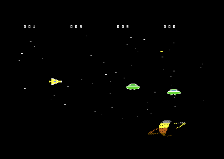

# RightForce

RightForce is a PAL Commodore 64 shoot-'em-up written in C and 6502 assembly
with [Oscar64](https://github.com/drmortalwombat/oscar64). It combines a
raster-driven virtual-sprite system, SID music, procedurally prepared scenery,
boss encounters, weapon upgrades and a special warp sequence.



## Build

Requirements:

- Oscar64 (the project was verified with version 1.32.273)
- PowerShell 7 or Windows PowerShell 5.1
- VICE with `x64sc` (optional, for running the result)

From the repository root:

```powershell
.\scripts\build.ps1 -Compiler 'C:\path\to\oscar64\bin\oscar64.exe'
```

Alternatively, set `OSCAR64_HOME` to the Oscar64 installation directory or
put `oscar64` on `PATH`, then run `./scripts/build.ps1`. The compiler writes
`build/RightForce.prg` and its diagnostic files under `build/`.

## Run in VICE

```powershell
.\scripts\run-vice.ps1 -Vice 'C:\path\to\VICE\bin\x64sc.exe'
```

To build and launch in one step:

```powershell
.\scripts\build.ps1 -Compiler 'C:\path\to\oscar64.exe' -Run -Vice 'C:\path\to\x64sc.exe'
```

VICE should use PAL timing. Autostart loads and runs the PRG. Joystick port 2
controls the ship, FIRE shoots, and SPACE activates WARP.

## Repository layout

```text
src/                  C and 6502/IRQ source modules
assets/runtime/       Binary data embedded by Oscar64
assets/music/         Original PSID files
assets/source-art/    Source artwork and visual references
scripts/              Build and VICE launch scripts
tools/                Reproducible asset-generation tools
docs/images/          Screenshots and generated previews
docs/GAMEPLAY-sl.md   Detailed Slovenian gameplay/technical notes
docs/MUSIC-CREDITS.md Music attribution and rights notice
build/                Local compiler output (ignored by Git)
```

The repository intentionally excludes obsolete game files and old root-level
Oscar64 outputs (`main.*` and `RightForce.asm/.map/.lbl/.int`).
Those files are generated again under `build/` when needed.

## Regenerate assets

Normal builds use the committed binary assets and do not require Python.
To regenerate them, install Python 3, Pillow and NumPy, then run:

```powershell
python -m pip install pillow numpy
python tools/generate_assets.py
python tools/convert_splash.py
```

## Status

The game has been exercised with VICE 3.10 using PAL timing, including the
three-minute boss cycle, warp sequence, upgrades, collisions and game-over
flow. Testing on a physical C64 is still pending.

See [the detailed gameplay and technical notes](docs/GAMEPLAY-sl.md) for the
full design and memory-map documentation.

## Music and licensing

Music credits and the redistribution warning are documented in
[docs/MUSIC-CREDITS.md](docs/MUSIC-CREDITS.md). Crediting a SID composer does
not by itself grant permission to redistribute the music.

No software licence has been selected for the RightForce source code. Until a
`LICENSE` file is added by the project owner, no reuse licence is granted.
